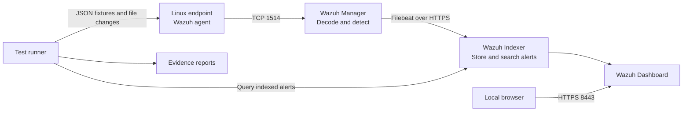

# Wazuh SIEM Home Lab

A reproducible security monitoring lab that collects endpoint events, applies
custom detections, and verifies alerts from collection through indexing.

**Wazuh 4.14.8 · Docker Compose · Python · Detection engineering · Incident analysis**

[Read the investigation](docs/INCIDENT-REPORT.md) ·
[View test evidence](evidence/published/validation-2026-10-05/REPORT.md) ·
[Explore the rules](config/local_rules.xml) ·
[Run the lab](docs/OPERATIONS.md)

## Project objective

Build a small SIEM environment with repeatable tests and traceable evidence.
The project combines custom JSON rules, authentication-event correlation,
real file integrity monitoring, and a documented investigation.

The monitored endpoint is a Linux container. Authentication, PowerShell and web
events are synthetic log fixtures; file creation, modification and deletion are
real operations inside the endpoint volume.

## Verified results

The baseline run on **5 October 2026** completed **13 checks** and exported
**14 alerts**. Three benign fixtures produced no indexed alert. These are results
from a small controlled dataset, not a measurement of production accuracy.

| Detection | Rule | Indexed alerts | Input |
| --- | --- | ---: | --- |
| Individual login failure | `100101` | 7 | Synthetic authentication event |
| Repeated login failures | `100102` | 1 | Correlated synthetic events |
| Privileged login | `100103` | 1 | Synthetic authentication event |
| Encoded PowerShell string | `100104` | 1 | Synthetic process event |
| Directory traversal string | `100105` | 1 | Synthetic web event |
| File added / modified / deleted | `554` / `550` / `553` | 3 | Real file operations |

The [incident report](docs/INCIDENT-REPORT.md) explains the alert timeline,
correlation behavior, matching file hashes, disposition and proposed improvements.
The [validation record](docs/VALIDATION.md) captures the tested environment.

## Architecture



Four containers share a dedicated Compose network. Only the dashboard is
published to the host, at `127.0.0.1:8443`. Manager, enrollment, indexer and API
ports stay inside the Docker network. The network can reach the internet.

## Implementation highlights

- **Deployment:** version-pinned Wazuh services, health checks, persistent volumes,
  TLS between central services and generated local credentials.
- **Detection:** five custom rules with JSON field matching and a correlation key
  that separates source addresses and test runs.
- **Verification:** rule-engine checks, benign controls, indexed-alert assertions
  and real FIM exercises with a unique file per run.
- **Investigation:** an evidence-linked report with alert IDs, timestamps, hashes,
  limitations and a proposed tuning plan.

## Quick start

Use an **AMD64** host with Docker Linux containers, Docker Compose v2+ and
Python 3.10+. Allocate at least **4 CPUs, 8 GB Docker RAM and 50 GB disk**;
10–12 GB Docker RAM is more comfortable. No Python packages are required.

Set `vm.max_map_count` to at least `262144`. On Windows with Docker Desktop/WSL 2:

```powershell
wsl -d docker-desktop -u root sysctl -w vm.max_map_count=262144
git clone https://github.com/DickaRaditya/SIEM-HOMELAB.git
cd SIEM-HOMELAB
python scripts/lab.py setup
python scripts/lab.py start
python scripts/lab.py credentials
```

Open **[https://localhost:8443](https://localhost:8443)** and sign in as `admin`
using the generated password. A private-CA certificate warning is expected for
this local lab. Initial setup downloads several GB of images; recheck the kernel
setting after restarting WSL. Linux setup and troubleshooting are in the
[operations guide](docs/OPERATIONS.md).

## Reproduce the tests

```powershell
python scripts/lab.py test
```

Success ends with `PASS: all scenarios verified.` Each run writes its report,
fixtures, indexed alerts and JSON check results to `evidence/runs/<RUN_ID>/`.
The [dashboard queries](docs/QUERIES.md) help inspect individual rules and FIM events.

```powershell
python scripts/lab.py status  # Container, indexer and agent status
python scripts/lab.py logs    # Recent service logs
python scripts/lab.py stop    # Stop while retaining data
```

## Repository map

| Path | Purpose |
| --- | --- |
| [`compose.yml`](compose.yml) | Four services, network exposure, health checks and storage |
| [`generate-certs.yml`](generate-certs.yml) | Local TLS certificate generation |
| [`config/`](config/) | Custom detection rules and endpoint collection/FIM settings |
| [`scripts/lab.py`](scripts/lab.py) | Setup, lifecycle, validation and evidence export |
| [`lab.ps1`](lab.ps1) | Optional Windows wrapper for the Python CLI |
| [`tests/`](tests/) | Regression checks for isolation and trustworthy reporting |
| [`docs/`](docs/) | Investigation, operations, queries, validation and optional endpoints |
| [`evidence/published/`](evidence/published/) | Reviewed baseline fixtures, actual alerts and results |
| [`vendor/wazuh/`](vendor/wazuh/) | Required upstream configuration, checksum manifest and license |

Generated `.env`, `runtime/`, `.cache/` and unreviewed test runs are ignored by
Git. Database data lives in Docker volumes; copying the repository does not
back up that data.

## Scope and limitations

This baseline validates the included container and fixture set. Native Windows
telemetry, real SSH attacks, containment, high availability, retention policies
and backup recovery are outside the verified scope. Inventory is enabled on the
endpoint; its SCA, rootcheck and automatic response are disabled. The manager's
vulnerability feed is disabled for the baseline.

The investigation includes concrete next steps. [Windows/LAN enrollment](docs/ENDPOINTS.md)
is documented as an optional extension requiring its own validation.

## License and provenance

Distributed under [GPL-2.0](LICENSE). See [third-party attribution](THIRD_PARTY.md)
for the exact Wazuh source commit and retained upstream file checksums.
Official references: [Docker deployment](https://documentation.wazuh.com/current/deployment-options/docker/wazuh-container.html)
and [custom rules](https://documentation.wazuh.com/current/user-manual/ruleset/rules/custom.html).
